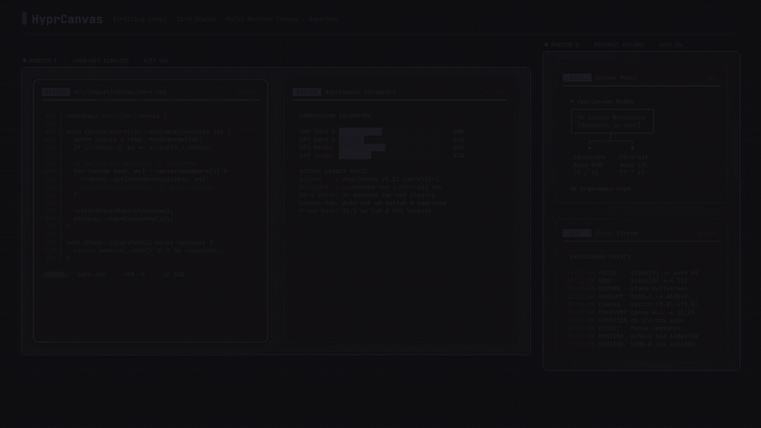

<div align="center">

# Karta

**A scrolling karta for your Hyprland desktop.**

Keep windows in stacks. Navigate with the keyboard. Switch your whole desktop across monitors.

[Get started](#get-started) · [User guide](docs/user-guide.md) · [Development](#development) · [Architecture](docs/architecture.md)

<br>



<sub>Landscape (<code>auto row</code>) + Portrait (<code>auto col</code>) dual-monitor demo: scrolling lanes, overlapping card stacks, in-place swap &amp; expand, cross-monitor transfer, synchronized 2D karta workspaces with Karta Map, and interactive Overview. Full 1080p60 recording: <a href="videos/karta-showcase.mp4"><code>videos/karta-showcase.mp4</code></a>.</sub>

</div>

---

Karta is a Hyprland layout plugin built around scrolling lanes, window
stacks, and karta workspaces. A karta groups one workspace per monitor, so
switching kartas changes the whole desktop together.

It grows out of [hyprscroller](https://github.com/dawsers/hyprscroller), with a
focus on multi-monitor navigation, overlapping window cards, and a workspace
overview.

## The desktop model

| Feature | What it does |
| --- | --- |
| **Scrolling lanes** | Arrange stacks horizontally or vertically and navigate beyond the visible monitor area. |
| **Window stacks** | Group related windows; stacks with three or more windows become overlapping cards with the focused window in front. |
| **Karta workspaces** | Switch a group of workspaces across all connected monitors in one action. |
| **Overview** | Preview kartas and select a window or workspace without rearranging the real windows. Accept to switch, or cancel to return. |
| **Keyboard movement** | Reorder windows, join or split stacks, exchange windows between stacks, and move between monitors. |
| **Focus and sizing** | Choose how many stacks fit on screen, expand a stack, or jump to a named window mark. |

## Compatibility

The current code targets **Hyprland 0.57 with Lua configuration**, with local
Release builds and logic tests verified against **Arch Linux Hyprland 0.57.2**.
Other versions are not guaranteed. Plugins use Hyprland's internal APIs and
must be rebuilt when Hyprland changes.

The project name and configuration names serve different purposes:

| Where | Name |
| --- | --- |
| `hyprpm` plugin | `karta` |
| Shared library | `karta.so` |
| Hyprland layout | `karta` |
| Lua functions | `hl.plugin.karta.*` |
| Plugin options | `plugin:karta:*` |

## Get started

### 1. Install through hyprpm

> **Migrating from hyprscroller or a manual `.so`?** Follow the
> [migration notes](docs/user-guide.md#migrating-an-existing-installation)
> before enabling the new plugin, and update existing `scroller` layout/Lua
> references to `karta`.

Run these as your normal user in a Hyprland session. Enter your sudo password
when the manager requests it.

```sh
hyprpm update
hyprpm add https://github.com/86kkd/karta.git
hyprpm enable karta
```

`hyprpm update` prepares the manager's Hyprland headers and updates registered
plugins. It does not update the `hyprpm` executable; your system package manager
does that. On first use, it may clone Hyprland to prepare its own header cache,
even if system development headers are already installed.

### 2. Configure startup and layout

Add this to `~/.config/hypr/hyprland.lua`. Put the layout setting after any
other module that selects a default layout.

```lua
hl.permission("/usr/(bin|local/bin)/hyprpm", "plugin", "allow")

hl.on("hyprland.start", function()
    hl.exec_cmd("hyprpm reload -n")
end)

hl.config({ general = { layout = "karta" } })
```

The startup hook loads enabled plugins when a new session starts. It does not
fetch updates. Remove any separate manual load of this plugin from your config.

### 3. Add keyboard controls

Use plugin functions for scrolling focus and window movement. These callbacks
resolve the functions when a key is pressed, after the plugin has loaded.
The bindings below are examples; adjust them to fit your configuration.

```lua
-- Focus and move windows in all four directions.
for _, spec in ipairs({
    { "LEFT", "l" }, { "RIGHT", "r" },
    { "UP", "u" }, { "DOWN", "d" },
}) do
    local key, direction = spec[1], spec[2]
    hl.bind("SUPER + " .. key, function()
        hl.plugin.karta.move_focus(direction)
    end)
    hl.bind("SUPER + CTRL + " .. key, function()
        hl.plugin.karta.move_window(direction)
    end)
end

-- Overview, stack expansion, and the number of visible stacks.
hl.bind("SUPER + O", function() hl.plugin.karta.toggle_overview() end)
hl.bind("SUPER + F", function() hl.plugin.karta.toggle_fullscreen() end)
hl.bind("SUPER + 2", function() hl.plugin.karta.set_window_size(2) end)
hl.bind("SUPER + 3", function() hl.plugin.karta.set_window_size(3) end)
```

For whole-desktop workspace switching, see
[karta workspace bindings](docs/user-guide.md#karta-workspaces).
The supplied workspace helper uses `SUPER + number` for kartas; if you use
it, move the two sizing shortcuts above to different keys.

### 4. Verify

```sh
hyprpm list
hyprctl plugin list
hyprctl getoption general:layout
```

Look for `karta` enabled in the manager, `Plugin karta` in the loaded
plugin list, and `karta` as the active layout. The startup hook takes effect
on your next login; `hyprpm enable` also attempts to load the plugin now.

## Update and manage

Save your work before updating: replacing a layout plugin can unload it and
change window placement.

| Task | Command |
| --- | --- |
| Update registered plugins | `hyprpm update` |
| Enable Karta | `hyprpm enable karta` |
| Load enabled plugins | `hyprpm reload -n` |
| Disable Karta | `hyprpm disable karta` |
| Inspect installed plugins | `hyprpm list` |
| Inspect plugins loaded in this session | `hyprctl plugin list` |

**`hyprpm` downloads, builds, and manages plugins. `hyprctl` controls the
running compositor.** You do not need `make install` or a manual
`hyprctl plugin load` for an installation managed by `hyprpm`.

After a Hyprland package upgrade, rebuild plugins with `hyprpm update` and
restart the Hyprland session before loading builds for the new version.
For local development, push the commits you want to distribute first:
`hyprpm` builds the published Git repository, not your working directory.

<details>
<summary>Troubleshooting the first install</summary>

- **`Headers missing`** — the manager's cache is missing, even if system
  headers exist. Run `hyprpm update` in a terminal and complete sudo authentication.
- **`Failed to write plugin state`** — inspect the preceding permission or sudo
  error. Retry the command in a terminal where you can authenticate.
- **Installed, but not loaded** — check `hyprpm list`, then run
  `hyprpm enable karta`. Use `hyprctl plugin list` to verify the result.
- **Still named `hyprscroller`** — an older build or repository record is in use.
  Follow the [migration notes](docs/user-guide.md#migrating-an-existing-installation).
- **Version or ABI mismatch** — make sure the running Hyprland session matches
  the installed package, update plugins, and restart the session as needed.

</details>

## Learn the controls

The [user guide](docs/user-guide.md) covers:

- [Karta workspaces and multi-monitor navigation](docs/user-guide.md#karta-workspaces)
- [Row and column modes, sizing, and card stacks](docs/user-guide.md#lanes-and-stacks)
- [Moving, splitting, and swapping windows](docs/user-guide.md#moving-windows)
- [Overview and marks](docs/user-guide.md#overview-and-marks)
- [Lua API and options](docs/user-guide.md#lua-api)

## Development

Build against the installed Hyprland development files:

```sh
make release
# Output: Release/karta.so
```

Build a debug configuration and run the logic tests:

```sh
cmake -S . -B Debug -DCMAKE_BUILD_TYPE=Debug
cmake --build Debug -j
ctest --test-dir Debug --output-on-failure
```

Use a [nested Hyprland session](docs/hyprland-testing.md) to test plugin loads
and layout changes. Do not run `make install` over a library loaded by your
active desktop: its current install target copies directly over the file.

| Resource | Purpose |
| --- | --- |
| [Architecture](docs/architecture.md) · [中文架构说明](docs/architecture-cn.md) | Runtime flow, ownership, and source map |
| [Testing guide](docs/hyprland-testing.md) | Nested sessions and reproducible scenarios |
| [Smoke checklist](docs/smoke-test-checklist.md) | Compositor-level regression checks |
| [Debug workflow](docs/feature-debug-workflow.md) | Investigating behavior changes |
| [Commit convention](docs/commit-convention.md) | Commit types, scopes, and verification notes |

Start reading at [`src/plugin/entry.cpp`](src/plugin/entry.cpp), then follow
[`src/plugin/dispatch/`](src/plugin/dispatch/) into
[`src/layout/karta/`](src/layout/karta/).

## Credits and license

Karta is a fork of [dawsers/hyprscroller](https://github.com/dawsers/hyprscroller),
inspired by [PaperWM](https://github.com/paperwm/PaperWM).
[hyprslidr](https://gitlab.com/magus/hyprslidr) helped inform the original plugin.

Released under the [MIT License](LICENSE).
